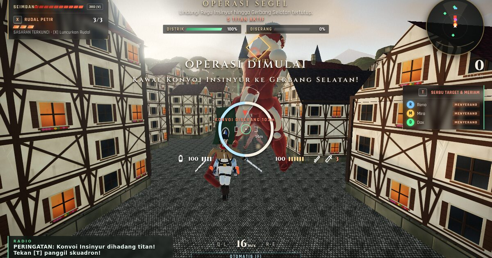

# WINGS OF STEEL

First-person ODM-gear tactical action game built with Three.js and Vite. Swing through Halvard District on dual grappling cables, command an AI Survey Corps squadron, escort the Engineer Convoy, and seal the South Gate against waves of Titans.



## Features

- **Grapple-First ODM Physics**: Smart dual or single-anchor grappling with pendulum swing momentum, mechanical winch reeling, wall-running, and apex slingshots.
- **Momentum-Vector Gas Boost**: Gas boost amplifies existing swing speed and smoothly curves your flight vector instead of acting like a flat jetpack.
- **Structural Destruction Physics**: Buildings fracture under impact stress and collapse into rigid-body roof slabs, walls, and timber beams.
- **First-Person Combat & Squad AI**: Custom first-person dual-blade viewmodel, nape execution lock-on, Thunder Spears, Garrison artillery, and three autonomous AI squadmates.
- **Full Settings & Remappable Controls**: Customize every keybind, audio channels (Master, Music, SFX), FOV, sensitivity, graphics quality, and soldier appearance.

## Game Modes

- **Operation: South Gate (Campaign)** — 5-phase mission with cinematic breach intro. Protect Halvard District and escort the Engineer Convoy to seal the wall.
- **Endless Defense** — Escalating Titan waves with between-wave field requisitions.
- **ODM Proving Grounds** — Aerial ring course and sparring Titans to master grappling and nape executions.

## Default Controls

| Input | Action |
| --- | --- |
| `Q` / `E` / Right Click | Left / Right / Dual ODM Grapple Hooks |
| `Space` | Winch Reel / Jump / Wall-Kick |
| `Shift` + `WASD` | Momentum Boost & Directional Vector Steer (`S`+`Shift` Air Brake) |
| Left Click | Slash / Nape Execution (Hold airborne for Spiral Slash) |
| `X` | Fire / Detonate Thunder Spear |
| `T` | Squad Focus Order & Garrison Artillery / Rally & Resupply |
| `R` / `C` | Swap Blades / Replace Gas Canister |
| `F` / `V` / `H` | Grapple Mode / Camera View / Controls Overlay |

All keyboard controls can be rebound in **Settings -> Controls**. Gamepad is also supported.

## Development & Static Deployment

```bash
npm install
npm run dev      # local dev server (:5173)
npm run build    # static bundle in dist/ (works on Cloudflare Pages, GitHub Pages, Netlify, etc.)
npm run verify   # headless Chrome verification suite
```

### Deploying to Cloudflare Pages / GitHub Pages

- **Cloudflare Pages**: Connect the repository, set Build command to `npm run build` and Build output directory to `dist`.
- **GitHub Pages**: Uses the included `.github/workflows/pages.yml` workflow automatically on push to `main`.
